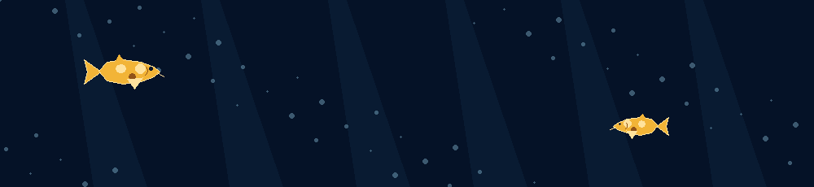
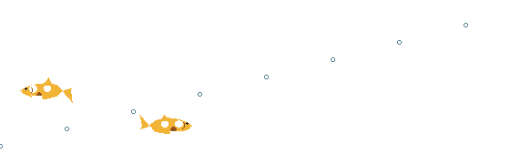

<!-- UNDERWATER HERO -->

  

<!-- MOVING KOI BETWEEN README SECTIONS -->

  

<!-- TECH STACK: keep your existing skillicons image -->

  
   
  

<!-- PLACE THIS AFTER PROJECTS OR STATISTICS -->

  

<!-- UNDERWATER FOOTER -->

  
  <em>Keep swimming. Keep building.</em>

SETUP:
1. Upload all four GIF files to the root of your profile repository.
2. Copy the snippets into README.md at the matching section positions.
3. Keep your existing profile.svg and other content.
4. GitHub README does not support custom CSS/JavaScript hover effects. GIF animation works; real hover effects require a separate website.
