 <!-- ========================= ANIMATED HERO ========================= -->

<div align="center">


<br/>

<a href="https://github.com/anshulchikhale30-p">

</a>


  
</div>

---

<!-- ========================= ABOUT ME ========================= -->

<h2 align="center">⚡ WHO AM I?</h2>

<div align="center">

```yaml
name: Anshul Chikhale
role: Developer | Open Source Contributor
education: Electronics & Telecommunication Engineering

interests:
  - Artificial Intelligence & Machine Learning
  - Cloud Native & Kubernetes
  - Distributed Systems
  - Competitive Programming
  - Open Source Development

currently:
  - Building AI-powered tools
  - Contributing to Open Source
  - Exploring Web3 + AI
  - Learning Go, Rust & Cloud Technologies

motto: "Code. Learn. Build. Repeat."
```

</div>

---

<!-- ========================= TECH STACK ========================= -->

<h2 align="center">🛠️ TECHNOLOGIES & TOOLS</h2>

<div align="center">


</div>

---

<!-- ========================= FEATURED PROJECTS ========================= -->

<h2 align="center">🚀 FEATURED PROJECTS</h2>

<div align="center">

<a href="https://github.com/anshulchikhale30-p/AP-CODE">

</a>

<a href="https://github.com/anshulchikhale30-p/llm-wiki">

</a>

</div>

---

<!-- ========================= GITHUB STATS ========================= -->

<h2 align="center">📊 GITHUB STATISTICS</h2>

<div align="center">


<br/>


</div>

---

<!-- ========================= TERMINAL ========================= -->

<h2 align="center">💻 MY DEVELOPER TERMINAL</h2>

<div align="center">



</div>

---

<!-- ========================= GOLDEN KOI ========================= -->

<div align="center">

<h2>🐟 KEEP SWIMMING. KEEP BUILDING.</h2>


<br/>

<em>Consistency creates extraordinary results.</em>

</div>

---

<!-- ========================= FOOTER ========================= -->

<div align="center">


**Thanks for visiting! Let's build something amazing. 🚀**

</div>
